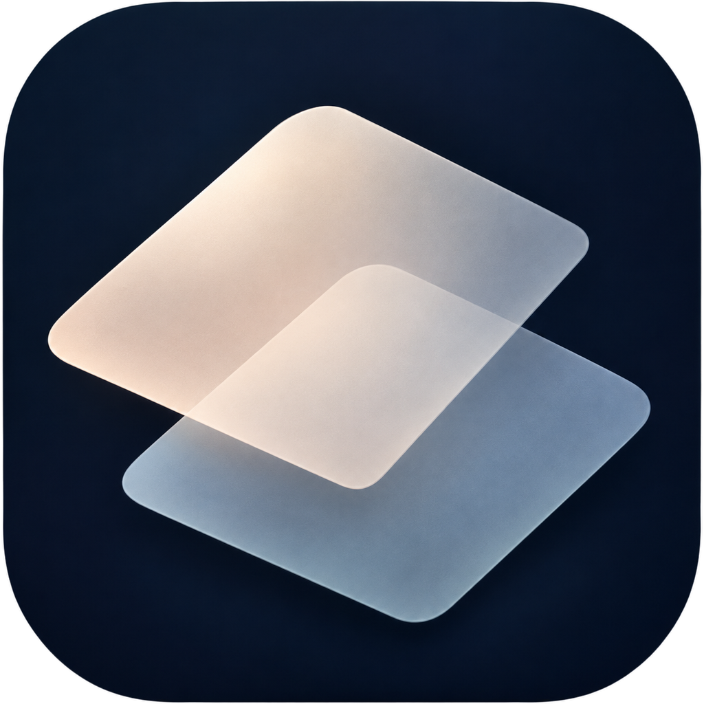

# MattePulp

[中文](README.md) | **English**

<p align="center">
  
</p>

**MattePulp covers the screen with a generated paper texture so a bright display reads like matte paper.**

<p align="center">
  
  
  
</p>

## Download

Download a published package first. The bilingual menus in this source tree are not in those packages yet.

| System | Release | File |
|---|---|---|
| Windows x64 | [v0.1.0](https://github.com/SueBwj/MattePulp/releases/tag/v0.1.0) stable | [sue-paper-v0.1.0-windows-x64.zip](https://github.com/SueBwj/MattePulp/releases/download/v0.1.0/sue-paper-v0.1.0-windows-x64.zip) |
| Mac Apple Silicon | [v0.1.1-macos.1](https://github.com/SueBwj/MattePulp/releases/tag/v0.1.1-macos.1) prerelease | [Sue-Paper-macOS-arm64-local-d9fb2c7.dmg](https://github.com/SueBwj/MattePulp/releases/download/v0.1.1-macos.1/Sue-Paper-macOS-arm64-local-d9fb2c7.dmg) |

Windows v0.1.0 (`53b266a`) still has the older tray art and a single-language UI with no language menu. The Mac prerelease (`d9fb2c7`, Apple Silicon only) already uses the current translucent paper icon, but menus stay mixed Chinese/English with no separate language item. The disk image is ad-hoc signed and not notarized; Gatekeeper may block a network download. Older `settings.json` files without a `language` field still load.

## Usage

The texture covers every screen. The pointer and keyboard pass through it; it does not take focus or appear in window switching. Mac display limits are in the [Mac notes](macos/README.md#display-behavior).

Four textures come from fractal noise and tile without a seam. Texture ids match the published packages (table below); intensity uses a 15%-30% slider in 1% steps on macOS and 4 levels (15% / 20% / 25% / 30%) on Windows.

In builds from this source, the Windows tray and Mac menu bar offer Original, Light Warm and Warm Paper under Tone. Original is the default. Every tone works with every texture and intensity, and the app remembers the chosen tone on restart.

| Settings id | English menu | Chinese menu | Character |
|---|---|---|---|
| ClassicMatte | Classic Matte | 经典哑光 | Clean, soft grain for reading |
| WhisperWeave | Whisper Weave | 织物纹理 | A fine weave that softens bright windows |
| Parchment | Sunbaked Parchment | 羊皮纸 | Warm, heavier grain |
| VellumMist | Vellum Mist | 薄纱雾面 | A light haze |

In a Windows build from this source, the Snooze menu adds "Resume now" while snoozing, which ends that snooze immediately. Snooze is not written to settings. When the foreground app is already excluded, the menu offers to include it, and the change takes effect immediately. The v0.1.0 package does not include these two actions.


In a build from this source, open **App profiles** and choose **Create profile for current app** to explicitly select the displayed app identity. Each profile has separate texture and intensity choices; choose **Use global** for either field to inherit its global setting. Edit or remove any saved profile from the same menu. Windows identifies apps by their executable path; macOS uses the bundle identifier or, when unavailable, the executable URL. A missing or unmatched identity uses global settings. Exclusions, manual disable, snooze and schedule rules still control visibility.

**Windows.** Unzip the stable package and run `sue-paper.exe`. When you build this source tree, right-click the tray icon: enable texture, texture/intensity/snooze, exclude the current app, language (中文 or English), and quit. The tray tip is 柔纸 in Chinese and MattePulp in English. Settings live in `%APPDATA%\Sue-Paper\settings.json`.

**Mac.** The published image still has the mixed menu and four fixed intensity items. Build `Sue-Paper.app` from this source and click **S** in the menu bar for a one-language menu with a separate language item and a focusable intensity slider panel (15%-30%, 1% steps: drag previews live and saves on release; arrow keys and accessibility adjustments save on every step). Finder shows MattePulp; the executable remains `Sue-Paper`. Settings live in `~/Library/Application Support/Sue-Paper/settings.json`. The app asks for neither Accessibility nor Screen Recording permission.

### Launch at login

In a build from source, **Launch at login** starts unchecked for a new user. Click it in the Windows tray or macOS menu bar to register MattePulp for your account. Click the checked item to turn it off. A disabled or pending registration stays unchecked and can be removed with **Remove login item**.

On Windows, extract the ZIP to a location where it can stay before enabling the option. Windows Task Scheduler starts that copy of `sue-paper.exe` at sign-in. If you move it, remove the old login item and enable it from the new copy. On macOS, the running app bundle is registered with the system. If the menu reports that approval is needed, check Login Items in System Settings.

### Schedule & Sunset

Open **Schedule & Sunset…** from the Windows tray or macOS menu bar in a build from source. Each rule starts disabled and can be switched on or off separately. Edit and save both rules in the same window, which shows current coverage and the estimated local time of the next automatic change.

- **Daily schedule** follows the system's local clock. Enter `HH:mm` in 24-hour format. The start minute is inclusive and the end minute is exclusive. An earlier end crosses midnight. Equal or malformed times make this rule unavailable. During daylight saving changes, both occurrences of a repeated minute are evaluated independently, and the first actual minute after a gap is evaluated as displayed.
- **Sunset** runs from sunset to the following sunrise. Enter decimal degrees from −90 to 90 for latitude and −180 to 180 for longitude, with positive values for north and east. Coordinates stay in the existing settings file on this device. Solar events follow the solar day at the entered longitude and are shown in the system time zone. Missing or invalid coordinates, or missing events needed to determine the current daylight or overnight interval, make the sunset rule unavailable. The estimate uses [NOAA GML's published equations](https://gml.noaa.gov/grad/solcalc/solareqns.PDF) rounded to the nearest minute. Atmosphere, terrain and high latitudes can widen the difference from observed events. [NOAA GML terms of use](https://gml.noaa.gov/about/disclaimer.html)
- **Either rule** can allow coverage. A daily window from 21:00 to 06:00 and sunset coverage from 18:10 to 06:45 allow coverage from 18:10 to 06:45. Manual disable, snooze and foreground app exclusions always hide the overlay. When all rules are disabled or unavailable, the manual setting applies.

MattePulp reevaluates against the current clock at startup, after waking, and after clock or time zone changes. The preview looks 48 hours ahead for the first change in the combined automatic rules, independent of manual disable, snooze and exclusions. If saving fails, the applied settings stay in effect and the window retains the edits for a retry.

With no saved language, the menu follows the system UI language. A choice is stored as `language` (`zh-Hans` or `en`); Windows and Mac use the same rules.

## Build and test

### Windows

Requires Rust stable (`stable-x86_64-pc-windows-gnu` or MSVC):

```sh
./build-release.ps1
```

The script writes `target/release/sue-paper.exe`, embeds `assets/sue-paper.ico`, and copies the repository `LICENSE` beside the executable. Ship only `sue-paper.exe` and that `LICENSE`, not the whole `target\release` tree.

```sh
cargo fmt -- --check
cargo clippy --all-targets -- -D warnings
cargo test --all-targets
```

### macOS (Apple Silicon)

Requires macOS 12+, Rust stable, and Xcode 16+ (`xcrun` must find Swift 6 and `swift-format`):

```sh
./build-macos.sh /tmp/mattepulp-build
./test-macos.sh /tmp/mattepulp-build
open /tmp/mattepulp-build/Sue-Paper.app
```

Use a fresh output directory each time. Outputs are `Sue-Paper.app` and `sue-paper-macos-arm64.zip`; `LICENSE` is in `Contents/Resources`, with an ad-hoc signature. Tests use temporary settings and synthetic windows and do not capture the desktop. See the [Mac build and validation notes](macos/README.md).

| File | Responsibility |
|---|---|
| `src/main.rs` | Entry point, hidden control window, message loop, menu commands |
| `src/locale.rs` | Simplified Chinese and English menus, and the system-language choice |
| `src/overlay.rs` | One layered window per screen, presented with `UpdateLayeredWindow` |
| `src/texture.rs` | Fractal noise and the four textures |
| `src/tray.rs` | Tray icon and context menu |
| `src/settings.rs` | `%APPDATA%/Sue-Paper/settings.json` |
| `assets/app-icon.png` | Icon artwork |
| `assets/app-icon-64.bgra` | Pixels embedded in the tray icon |
| `assets/sue-paper.ico` | Multi-size icon embedded in the Windows executable |
| `macos/` | AppKit menu bar, overlays, settings, and tests |

## Feedback

Open questions on [GitHub Issues](https://github.com/SueBwj/MattePulp/issues). The source repository is [SueBwj/MattePulp](https://github.com/SueBwj/MattePulp).

## Credits

- The idea of a digital matte surface comes from [Paperman](https://paperman.cc).

## Contributors

- [SueBwj](https://github.com/SueBwj)
- Codex

## License

Source code and documentation in this repository are under the MIT license, `Copyright (c) 2026 SueBwj`. The text is in [LICENSE](LICENSE).

That grant does not cover the screenshots, the app icon, product marks, or other media, and it does not replace the licenses that come with dependencies. `windows`, `serde`, and `serde_json` keep the licenses published with those crates.

Redistribute the copyright notice and the permission notice with the program. The Windows build script places `LICENSE` next to `sue-paper.exe`. The Mac build script places it in the app bundle's `Contents/Resources`.
