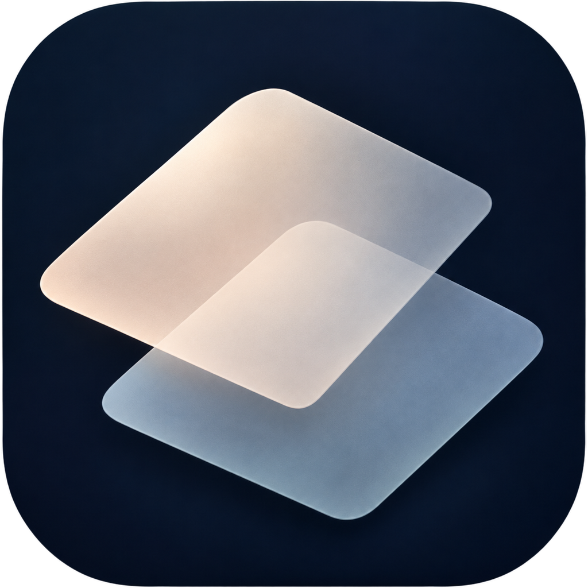
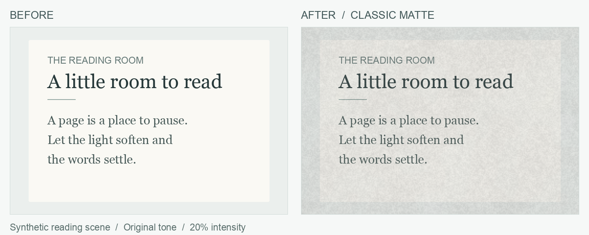
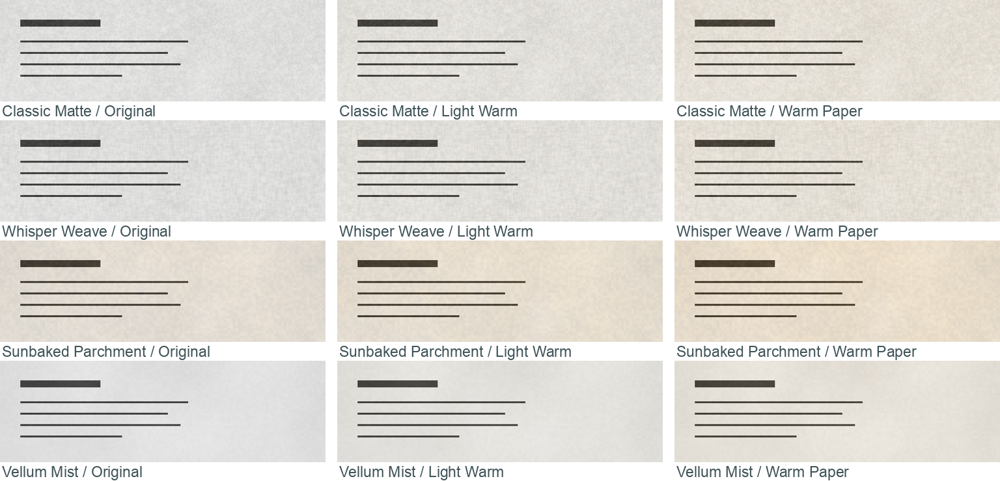

<h1 align="center">MattePulp</h1>

<p align="center"><b>中文</b> | <a href="README.en.md">English</a></p>

<p align="center"></p>

<p align="center"><b>让屏幕的光，柔和一点。</b><br>MattePulp（柔纸）在屏幕上铺一层生成的纸纹，让发亮的显示看起来像一张哑光纸。</p>

<p align="center"><a href="#下载">下载</a> · <a href="#使用">使用</a> · <a href="#构建与测试">构建与测试</a></p>



<sub>合成阅读场景，右侧叠加源码生成的经典哑光纹理：原色，20% 强度。</sub>

## 找到你的纸感

四种纹理与三种色调可以自由组合。下图是源码生成的合成样本，强度均为 20%；色调功能在源码构建中提供。



| 安静覆盖 | 自由穿透 |
|---|---|
| 纸纹覆盖屏幕，生成的纹理可无缝平铺。 | 鼠标和键盘直接穿过，不抢焦点。 |
| **四种纹理** | **三种色调** |
| 经典哑光、织物纹理、羊皮纸、薄纱雾面。 | 原色、浅暖、暖纸可与任意纹理搭配（源码构建）。 |
| **调节强度** | **按需出现** |
| Windows 四档，源码构建的 macOS 为 15%-30% 滑杆。 | 打盹、应用排除，以及源码构建中的定时与日落。 |

## 下载

先下载已发布的安装包。当前源码里的双语菜单还没有打进这些安装包。

| 系统 | 版本 | 文件 |
|---|---|---|
| Windows x64 | [v0.1.0](https://github.com/SueBwj/MattePulp/releases/tag/v0.1.0) 稳定版 | [sue-paper-v0.1.0-windows-x64.zip](https://github.com/SueBwj/MattePulp/releases/download/v0.1.0/sue-paper-v0.1.0-windows-x64.zip) |
| Mac Apple Silicon | [v0.1.1-macos.1](https://github.com/SueBwj/MattePulp/releases/tag/v0.1.1-macos.1) 预发布 | [Sue-Paper-macOS-arm64-local-d9fb2c7.dmg](https://github.com/SueBwj/MattePulp/releases/download/v0.1.1-macos.1/Sue-Paper-macOS-arm64-local-d9fb2c7.dmg) |

<details>
<summary>已发布版本与当前源码的区别</summary>

Windows v0.1.0（`53b266a`）仍是旧托盘图标和单一界面，没有语言菜单。Mac 预发布（`d9fb2c7`，仅 Apple Silicon）已用当前半透明纸图标，但菜单仍是中英混排、无单独语言项；镜像只做 ad-hoc 签名、未公证，从网络下载时 Gatekeeper 可能拦截。旧版 `settings.json` 没有 `language` 字段也能继续用。

</details>

## 使用

纸纹盖住每块屏幕，鼠标和键盘直接穿过，不拿焦点，也不出现在窗口切换里。Mac 的显示范围见 [Mac 说明](macos/README.md#display-behavior)。

四种纹理由分形噪声生成，可无缝平铺，纹理编号与已发布包一致（见下表）；从源码构建时，强度在 macOS 上为 15%-30% 滑杆（1% 步进），在 Windows 上为 15% / 20% / 25% / 30% 四档。

从源码构建的 Windows 托盘和 Mac 菜单栏都可在「色调」中选择「原色」「浅暖」「暖纸」。原色是默认值，暖色调可搭配任意纹理与强度，选择会在重启后恢复。

| 设置编号 | 英文菜单 | 中文菜单 | 观感 |
|---|---|---|---|
| ClassicMatte | Classic Matte | 经典哑光 | 干净、柔和，适合阅读 |
| WhisperWeave | Whisper Weave | 织物纹理 | 细密织纹，压住刺眼的亮色 |
| Parchment | Sunbaked Parchment | 羊皮纸 | 暖色，颗粒更重 |
| VellumMist | Vellum Mist | 薄纱雾面 | 很轻的一层雾 |

从这棵源码编译的 Windows 托盘里，打盹期间打盹菜单会多出「立即恢复」，用来马上结束这次打盹。打盹不写入设置。当前应用已在排除列表里时，菜单改为取消排除，更改马上生效。v0.1.0 稳定包没有这两项。


**Windows。** 解压稳定包后运行 `sue-paper.exe`。从源码运行时右键托盘图标：启用纹理、纹理/强度/打盹、排除当前应用、语言（中文或 English）、退出。托盘提示在中文下是「柔纸」，英文下是 MattePulp。设置文件在 `%APPDATA%\Sue-Paper\settings.json`。

**Mac。** 打开已发布的镜像，启动其中的应用。已发布镜像仍是混排菜单与四档固定强度。从源码构建 `Sue-Paper.app` 后点菜单栏 **S**：整份菜单只用一种语言，可单独选语言，并可通过「强度 - N%」弹出可聚焦的原生滑杆面板（15%-30%，1% 步进；拖动实时预览、松开保存，键盘方向键与辅助功能调节每次即保存）。Finder 显示名是 MattePulp，可执行文件仍是 `Sue-Paper`；设置在 `~/Library/Application Support/Sue-Paper/settings.json`。不需要辅助功能或屏幕录制权限。

### 登录时启动

从源码构建的版本默认不勾选「登录时启动」。在 Windows 托盘或 macOS 菜单栏点击该项，为当前账户启用；再次点击已勾选的项目即可关闭。系统已停用或待批准的项目保持未勾选，可用「移除登录项」撤销。

Windows 上请先将 ZIP 解压到准备长期保留的位置，再启用此选项。Windows 任务计划程序会在登录时打开该位置的 `sue-paper.exe`。移动程序后，请先移除原登录项，再从新位置启用。macOS 会登记当前运行的应用包。如菜单显示需要批准，可前往系统设置的登录项查看。

### 定时与日落

从源码构建的 Windows 和 macOS 版本可通过托盘或菜单栏打开「定时与日落…」。两项默认关闭，可分别启用。在同一窗口编辑并保存，可查看当前覆盖状态和下次自动变化的预计本地时间。

- **定时**使用系统本地时间，格式为 `HH:mm`。开始分钟计入时段，结束分钟不计入。结束早于开始表示跨午夜，两者相同或格式有误时定时暂不可用。夏令时回拨时重复的分钟两次都按同一规则判断，快进时以跳转后的实际分钟判断。
- **日落**从当地日落到次日日出。手动填写十进制度数，纬度范围为 −90 至 90，经度范围为 −180 至 180，东经和北纬为正。坐标仅保存在原本机设置文件中。规则按经度所对应的太阳日计算，以实际发生的时刻为边界，再按系统时区显示。坐标缺失、不合法或缺少计算当前昼夜区间所需的太阳事件时，日落暂不可用。日落和日出估算采用 [NOAA GML 公开方程](https://gml.noaa.gov/grad/solcalc/solareqns.PDF)，四舍五入至最近一分钟。大气、地形及高纬度会影响估算和实际观测的差异。[NOAA GML 使用条款](https://gml.noaa.gov/about/disclaimer.html)
- **组合**满足任一有效规则就允许覆盖。例如定时 21:00 至次日 06:00、日落 18:10 至次日 06:45 时，自动允许时段为 18:10 至次日 06:45。手动关闭、打盹及前台应用排除优先隐藏。全部规则不可用或关闭时，回到手动设置。

启动、唤醒、时钟或时区改变后按当时状态重新计算。预览查找未来 48 小时内自动规则合成结果的第一次变化，估算不考虑临时打盹、排除和手动关闭。保存失败时原规则继续生效，窗口保留编辑内容供重试。

未保存语言时，菜单跟随系统界面语言；选定后写入 `language`（`zh-Hans` 或 `en`），Windows 与 Mac 规则相同。

## 构建与测试

### Windows

需要 Rust stable（`stable-x86_64-pc-windows-gnu` 或 MSVC）：

```sh
./build-release.ps1
```

脚本生成 `target/release/sue-paper.exe`，嵌入 `assets/sue-paper.ico`，并把根目录 `LICENSE` 复制到可执行文件旁。分发时请只带上 `sue-paper.exe` 与同目录 `LICENSE`，不要打包整个 `target\release`。

```sh
cargo fmt -- --check
cargo clippy --all-targets -- -D warnings
cargo test --all-targets
```

### macOS（Apple Silicon）

需要 macOS 12+、Rust stable、Xcode 16+（`xcrun` 能找到 Swift 6 与 `swift-format`）：

```sh
./build-macos.sh /tmp/mattepulp-build
./test-macos.sh /tmp/mattepulp-build
open /tmp/mattepulp-build/Sue-Paper.app
```

每次构建使用新的输出目录。产物为 `Sue-Paper.app` 与 `sue-paper-macos-arm64.zip`；`LICENSE` 在 `Contents/Resources`，构建为 ad-hoc 签名。测试用临时设置与合成窗口，不截取桌面。细节见 [Mac 构建与验证说明](macos/README.md)。

| 文件 | 职责 |
|---|---|
| `src/main.rs` | 入口、隐藏控制窗口、消息循环、菜单命令 |
| `src/locale.rs` | 简体中文和英文菜单，以及系统语言判断 |
| `src/overlay.rs` | 每屏一个分层窗口，并用 `UpdateLayeredWindow` 上屏 |
| `src/texture.rs` | 分形噪声和四种纹理 |
| `src/tray.rs` | 托盘图标和右键菜单 |
| `src/settings.rs` | `%APPDATA%/Sue-Paper/settings.json` |
| `assets/app-icon.png` | 图标原图 |
| `assets/app-icon-64.bgra` | 编进托盘图标的像素 |
| `assets/sue-paper.ico` | 写进 Windows 可执行文件的多尺寸图标 |
| `macos/` | AppKit 菜单栏、覆盖层、设置和测试 |

## 反馈

问题请开到 [GitHub Issues](https://github.com/SueBwj/MattePulp/issues)。源码仓库是 [SueBwj/MattePulp](https://github.com/SueBwj/MattePulp)。

## 致谢

- 数字哑光表面这个想法来自 [Paperman](https://paperman.cc)。

## 贡献者

- [SueBwj](https://github.com/SueBwj)
- Codex

## 许可

仓库里的源码和文档使用 MIT 许可，版权行为 `Copyright (c) 2026 SueBwj`。全文见 [LICENSE](LICENSE)。

这次许可不覆盖截图、应用图标、产品标识和其他媒体，也不改变第三方依赖自带的许可。`windows`、`serde` 和 `serde_json` 仍使用它们各自发布的许可。

再分发程序时，请保留上述版权声明和许可声明。Windows 构建脚本把 `LICENSE` 放在 `sue-paper.exe` 旁边。Mac 构建脚本把它放进应用包的 `Contents/Resources`。
